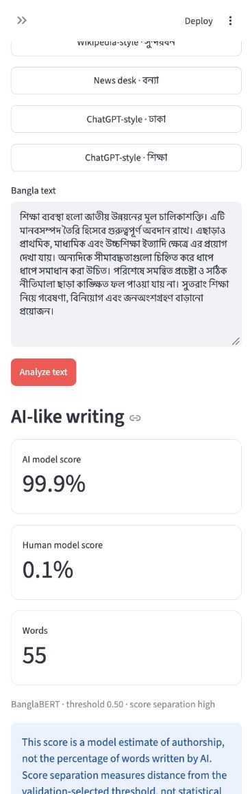
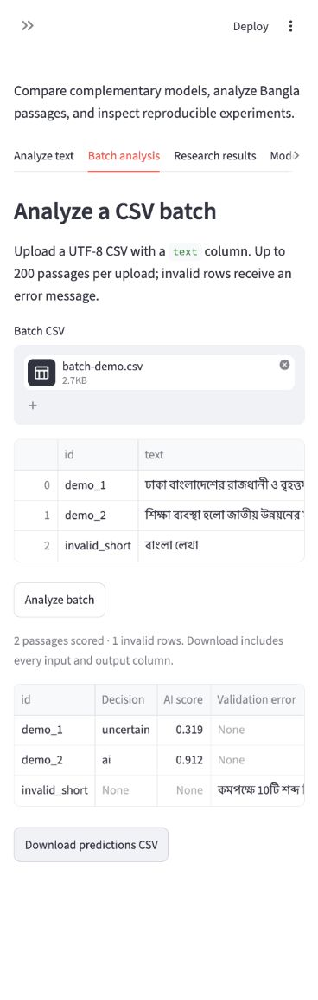
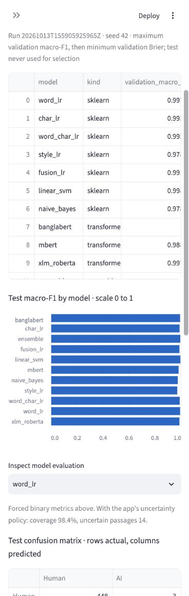
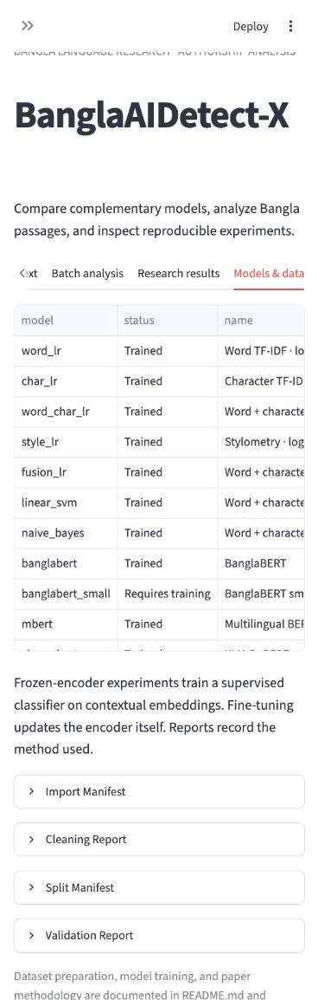
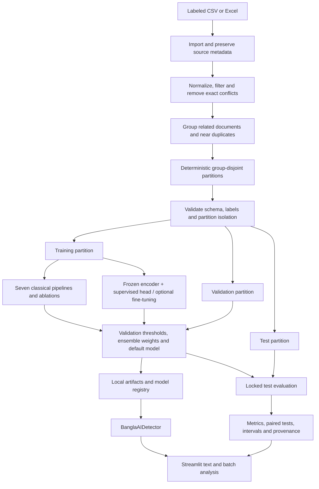
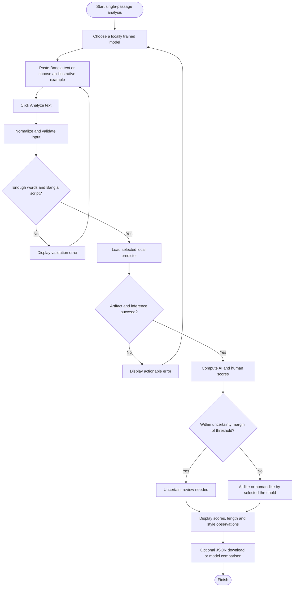
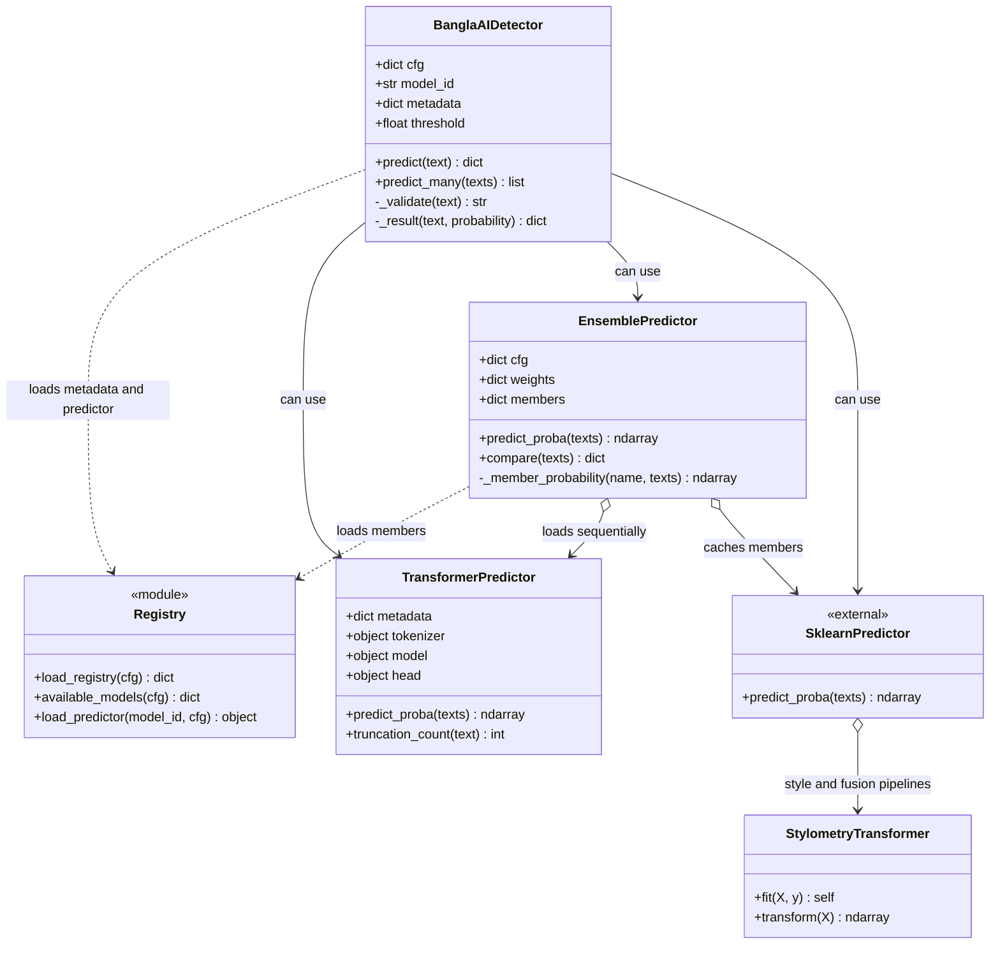
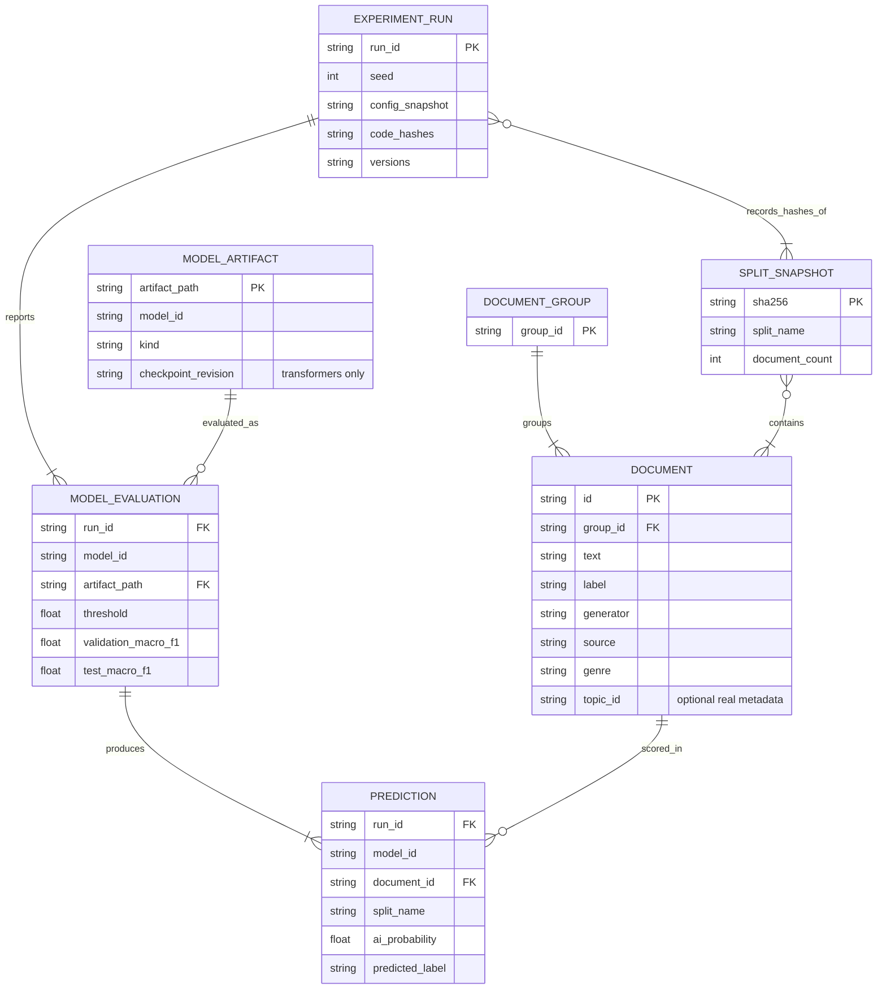

# BanglaAIDetect-X

**Bangla authorship analysis with classical models, BanglaBERT, multilingual encoders, and reproducible experiments.**

A Streamlit research application for comparing human-like and AI-like Bangla writing. Includes passage analysis, CSV batch scoring, model comparison, data audits, and an experiment explorer. Bangla script is the evaluated language; English and Banglish are outside the evaluation scope.

[](https://github.com/nahianzarif1/BanglaAIDetect-X/actions/workflows/tests.yml)

[Quick start](#quick-start) · [Model status](#completed-models-and-measured-results) · [Demonstration](#application-demonstration) · [Input guide](#what-to-enter-and-how-to-read-a-result) · [Diagrams](#system-design) · [Research protocol](RESEARCH_GUIDE.md)

> **Status verified October 25, 2026:** 11 trained detector choices are available locally: seven classical models, three frozen transformer encoders with supervised classifiers, and one ensemble. BanglaBERT small is supported but untrained. The reported experiment was run on October 13; verification and documentation were completed on October 25. Trained weights are excluded from Git, so a fresh clone must train its own artifacts.
>
> High scores on this corpus do not establish reliable detection on arbitrary new text. This is a research prototype; model scores are not proof of authorship or evidence sufficient for an academic-integrity decision.

## Quick start

Use Python 3.11–3.13; the verified local environment uses Python 3.13. A CPU is sufficient for the classical models. Run these commands from the repository root:

```bash
git clone https://github.com/nahianzarif1/BanglaAIDetect-X.git
cd BanglaAIDetect-X
python3 -m venv .venv
source .venv/bin/activate
python -m pip install -r requirements.txt

# Import, clean, split, validate, train seven classical models, and evaluate.
python run_pipeline.py

# Open http://localhost:8501 in your browser.
streamlit run app/app.py
```

Windows activation: `.venv\Scripts\activate`. Stop the server with `Ctrl+C`.
If compatible models already exist on this machine, launch Streamlit directly to keep them. A fresh pipeline run regenerates splits; use `--reuse-splits` when adding models to the existing experiment.

The default labeled workbook is `data/raw/ieee_dataport_dataset.xlsx`, which was already present in the repository. Its filename alone does not establish dataset provenance or redistribution permission; verify the original source and terms before publication. A missing real dataset is an error; training never silently substitutes synthetic data.

To use another labeled corpus:

```bash
python run_pipeline.py --dataset /path/to/dataset.csv
```

Required columns are `text,label`, with labels `human` or `ai`. Recommended metadata: `id,generator,source,genre,topic_id,parent_id,prompt_id,writer_subgroup`. Preserve genuine relationships and leave unknown values missing. The importer also supports the supplied Excel schema `source_text,Source,Source Name` and rejects unknown source labels unless explicit labels are provided. The inference batch schema is simpler: it only needs `text`.

## Completed models and measured results

**Ten individual models + one validation-weighted ensemble = 11 trained choices.** All entries below have verified local artifacts and test predictions. Percentages are rounded from the committed [aggregate comparison CSV](docs/results/model-comparison.csv); macro-F1 is shown as a percentage for readability.

| Model ID | Representation / training | Validation macro-F1 | Test accuracy | Test macro-F1 |
|---|---|---:|---:|---:|
| `word_lr` | Word TF-IDF + logistic regression | 99.78% | 99.67% | 99.67% |
| `char_lr` | Character TF-IDF + logistic regression | 99.33% | 99.33% | 99.33% |
| `word_char_lr` | Word + character TF-IDF + logistic regression | 99.55% | 99.44% | 99.44% |
| `style_lr` | Stylometry-only logistic regression; ablation | 97.88% | 97.55% | 97.55% |
| `fusion_lr` | Word + character + stylometry; calibrated logistic regression | 99.11% | 99.22% | 99.22% |
| `linear_svm` | Word + character; calibrated linear SVM | 99.89% | 99.89% | 99.89% |
| `naive_bayes` | Word + character; Complement Naive Bayes | 97.88% | 97.88% | 97.88% |
| `banglabert` | Frozen BanglaBERT + trained logistic head | 100.00% | 99.67% | 99.67% |
| `mbert` | Frozen multilingual BERT + trained logistic head | 98.89% | 98.55% | 98.55% |
| `xlm_roberta` | Frozen XLM-RoBERTa + trained logistic head | 99.78% | 99.22% | 99.22% |
| `ensemble` | Nonnegative weights fitted on validation log loss | 100.00% | 99.78% | 99.78% |

**Default: BanglaBERT**, selected by validation macro-F1, with validation Brier score breaking ties. The SVM's higher test score did not determine the default. Ensemble weights are approximately 54.76% BanglaBERT, 30.17% SVM, and 15.07% XLM-R; the remaining fitted weights are zero.

**Not completed:** `banglabert_small` has an implementation but no completed training run. Full encoder fine-tuning is implemented and tested with a tiny offline encoder; the three full-size checkpoint results above use **frozen encoders**, not end-to-end fine-tuning. Adding a model does not guarantee improved accuracy.

### Evaluation scope

| Dataset stage | Documents | Human | AI |
|---|---:|---:|---:|
| Imported workbook | 5,999 | — | — |
| Cleaned corpus | 5,989 | 3,000 | 2,989 |
| Train | 4,194 | 2,100 | 2,094 |
| Validation | 898 | 449 | 449 |
| Test | 897 | 451 | 446 |

The seed-42 partition groups related records and detected near duplicates before splitting. There are 5,979 groups and 10 detected near-duplicate links at token-trigram Jaccard ≥ 0.90. No genuine semantic topic IDs were available, so **this is not a topic-held-out experiment**. The high test results may reflect corpus, source, genre, or generator cues. External-corpus, unseen-generator, multiple-seed, and independently annotated evaluations remain necessary.

Inspectable evidence: [experiment summary, intervals, versions and split hashes](docs/results/experiment-summary.json), [paired comparisons](docs/results/paired-comparisons.json), and [research limitations and next experiments](RESEARCH_GUIDE.md). These public snapshots exclude passage text, per-document predictions, and private local paths. Recovered transformer artifacts disclose missing original training runtime/source records in the full local reports.

## Application demonstration

These are captures of the running application, taken on October 25, 2026. Example passages illustrate styles and have no independently verified authorship labels; the screens demonstrate operation, not accuracy.

### 1. Analyze a passage with BanglaBERT

Choose a trained detector, enter Bangla text, and click **Analyze text**. The app displays the selected model, threshold, scores, word count, uncertainty decision, style observations, and a JSON download.



### 2. Analyze a CSV batch

Upload a UTF-8 CSV containing `text`, click **Analyze batch**, and download the resulting scores. Invalid rows receive individual error messages. The committed [demo CSV](docs/examples/batch-demo.csv) includes valid style examples and one intentionally too-short input.



### 3. Inspect the measured experiment

The research tab presents measured test results, macro-F1, confusion matrices, calibration, group bootstrap intervals, and subgroup diagnostics. Model selection uses validation data.



### 4. Check which models are actually trained

The inventory distinguishes trained artifacts from supported checkpoints that still require training, and exposes ingestion, cleaning, split, and validation audits.



See [the demonstration walkthrough](docs/DEMONSTRATION.md) for reproducible steps and screenshot context.

## What to enter and how to read a result

1. Choose a detector in the sidebar. Use `linear_svm` for a quick CPU comparison or BanglaBERT for the validation-selected default.
2. Paste a coherent Bangla passage. The app requires at least **10 words**, at least 75% Bangla among alphabetic characters, and no more than 100,000 characters. For a more informative demonstration, use roughly 80–150 words; this is practical guidance, not a measured accuracy guarantee.
3. Click **Analyze text**. Changing the passage clears its old result. Changing the selected model requires another analysis; a previous-model result is explicitly identified.
4. Compare models on the same passage when useful, inspect the limitations, and download the analysis if needed.

| Output | Meaning |
|---|---|
| AI / human model score | Complementary model estimates; not the proportion of AI-written words |
| AI-like / human-like | Score falls on one side of the validation-selected threshold, outside the uncertainty band |
| Uncertain | Score is within 0.08 of that model's threshold; review is required |
| Score separation | Distance from the threshold; not statistical confidence |
| Style observations | Descriptive heuristics; not a faithful explanation of every model or proof of authorship |
| Truncation notice | A transformer used only the first configured 256 subword tokens |

**When can it work well?** Longer, unedited Bangla prose resembling the evaluated corpus supplies more relevant evidence. A correct result can only be established against known authorship, such as your own independently written passage or an unedited, logged model generation. Test both classes and record errors.

**When can it fail?** Short text, mixed human/AI edits, paraphrasing, translation, unseen generators, new domains, code switching, poetry, lists, or formulaic human writing may shift predictions. Even polished human prose can receive a high AI score. The built-in Wikipedia-style and ChatGPT-style buttons are illustrative text, not independently sourced test labels. Do not tune the app to make these examples look correct or count them as an evaluation set.

### Batch CSV format

```csv
id,text
example_1,"একটি সম্পূর্ণ বাংলা অনুচ্ছেদ এখানে লিখুন যাতে অন্তত দশটি শব্দ থাকে।"
example_2,"আরেকটি বাংলা অনুচ্ছেদ এখানে লিখুন এবং প্রতিটি ইনপুটের যথেষ্ট প্রাসঙ্গিক লেখা রাখুন।"
```

The batch tab accepts up to **200 rows** and **10 MB**. Extra columns are preserved; new outputs use the `detector_` prefix. A training or independent evaluation dataset also requires ground-truth `label`, whereas inference does not.

## Training and reproducibility

### Classical baselines and ablations

```bash
# Default: all seven classical models plus an ensemble when eligible.
python run_pipeline.py

# Choose a subset; keep the current validated partitions.
python run_pipeline.py --reuse-splits --models word_lr char_lr linear_svm
```

Word features preserve Bangla characters and use whitespace tokens; character n-grams complement lexical features. Calibration for the fusion and SVM pipelines respects document groups. Validation selects thresholds, the default detector, and nonnegative ensemble weights. The locked test partition is used for reporting.

### Transformer models

```bash
python -m pip install -r requirements-transformers.txt

# Add the three principal encoders to the same experiment partitions.
python run_pipeline.py --reuse-splits --models banglabert mbert xlm_roberta

# Supported lighter checkpoint; not part of the reported completed run.
python run_pipeline.py --reuse-splits --models banglabert_small

# Optional end-to-end encoder training; this is a NEW experiment.
python run_pipeline.py --reuse-splits --models banglabert --transformer-mode finetune

# Fresh experiment: seven classical models and the three principal encoders.
python run_pipeline.py --all-models
```

Default transformer mode: frozen contextual embeddings and a supervised logistic classifier. Fine-tuning updates encoder weights. CUDA or Apple MPS is selected when available; otherwise CPU. Downloads need internet access, several GB of free storage, and sufficient RAM. Full fine-tuning requires considerably more compute. BanglaBERT uses the [BUET normalization pipeline](https://github.com/csebuetnlp/normalizer). Checkpoint revisions and length policies are recorded; trained inference loads local artifacts.

### Reports, recovery and independent evaluation

```bash
# Paired group permutation tests, macro-F1 bootstrap deltas and Holm adjustment.
python -m src.paired_comparison

# Rebuild reports / ensemble from saved compatible predictions, no retraining.
python run_pipeline.py --refresh-only

# Recover completed transformer artifacts from an interrupted run.
python run_pipeline.py --reuse-splits --models banglabert mbert xlm_roberta \
  --resume-artifacts models/artifacts/<interrupted_run_id>

# Evaluate a locked detector on an independently labeled corpus.
python -m src.evaluate_external --dataset /path/to/external.csv --model linear_svm

# Regenerate the aggregate documentation snapshot after a verified experiment.
python scripts/export_documentation_snapshot.py

# Run automated checks.
python -m pytest tests -q
```

Recovery requires matching split hashes, seed, mode, and model identity; incompatible or provenance-free artifacts are rejected. The external evaluator rejects exact training/validation overlap by default. Any `--allow-overlap` run is diagnostic, not independent evidence. It does not establish that an external corpus is free of all semantic or near-duplicate leakage; curate that independently.

| Local output | Purpose |
|---|---|
| `models/registry.json` | Artifact inventory, thresholds, default model and ensemble weights |
| `models/artifacts/<run_id>/` | Trained classical pipelines and local transformer checkpoints |
| `results/experiments/<run_id>/` | Frozen config/code, hashes, versions, metrics, predictions and errors |
| `results/reports/` | Latest ingestion, cleaning, split and validation audits |
| `results/external/` | Independent-corpus evaluation outputs |
| `docs/results/` | Committed aggregate snapshot of the documented experiment |

Accuracy, macro-F1, AI precision/recall/F1, balanced accuracy, MCC, ROC-AUC, PR-AUC, Brier score, log loss, ECE, human false-positive rate, confusion matrices, group bootstrap intervals, subgroup results, and uncertainty-policy coverage are available in the full local reports. Binary test metrics force a label for each passage; the application's uncertainty policy is reported separately.

The local `requirements-lock.txt` records the verified environment; use regular requirements on other platforms. CI checks the base application and data pipeline on Python 3.12. Optional neural checks run when transformer dependencies are installed; the tiny offline encoder exercises save/reload and fine-tuning without downloading a large model.

## System design

The following diagrams use GitHub-native Mermaid. Editable sources are stored in [docs/diagrams](docs/diagrams).

### Architecture and experiment boundaries



### Activity: single-passage analysis



### UML class and module relationships

The diagram summarizes implemented classes and the registry module. `SklearnPredictor` represents external scikit-learn pipeline/calibrated-classifier objects. Predictors share the `predict_proba` convention through duck typing; no additional abstract predictor base class is implemented.



### ER: logical research artifacts

This ER diagram describes relationships across CSV, JSON, and model artifacts. **No relational database server or ORM is implemented.** Keys describe logical identities; prediction identity combines run, model, split, and document. Split SHA-256 hashes identify the file snapshots reused across compatible runs.



## Repository map

```text
app/                         Streamlit UI, examples and presentation helpers
src/config.py                Validated configuration and absolute path resolution
src/data/                    Import support, cleaning, grouping, splitting, validation
src/preprocessing/           Bangla normalization
src/features/                Stylometry features
src/models/                  Classical / transformer training, catalog and registry
src/experiment.py            Training, selection, evaluation and provenance
src/inference.py             Validated text and batch prediction
src/research.py               Metrics, calibration, intervals and subgroup analysis
src/paired_comparison.py      Paired statistical comparisons
src/evaluate_external.py      Locked-model independent-corpus evaluation
run_pipeline.py              Command-line workflow
scripts/                     Aggregate documentation export
tests/                      Automated application, data and model checks
docs/                       Screenshots, Mermaid sources and aggregate evidence
```

## Troubleshooting

| Symptom | Action |
|---|---|
| No trained models in the sidebar | Run `python run_pipeline.py`; Git does not contain trained weights or the generated registry. |
| Missing transformer packages | Install `requirements-transformers.txt` in the same activated environment used by Streamlit. |
| Port 8501 is occupied | Reuse the running project server or stop its old process; use `--server.port 8502` for a separate instance. |
| Old UI or imports after an upgrade | Stop Streamlit with `Ctrl+C` and restart from the activated environment. A long-running process can retain old imports. |
| Empty, too short, or non-Bangla input | Provide a coherent Bangla passage that satisfies the validation rules. |
| Dataset, schema, or class validation failure | Supply genuine labels and metadata; inspect the audit report instead of bypassing the error. |
| Disk full during model download/export | Free several GB, then use compatible artifact recovery. Do not remove the only trained artifacts. |
| Slow first neural prediction | Loading local encoder weights takes time; use the SVM for a quick CPU demonstration. |
| Split hash mismatch | Use the original partitions for recovery; start a new experiment when data/partitions change. |
| Unexpected AI-like result for human prose | Record it as an error against independently known authorship; compare models and evaluate domain shift. A high score is not proof. |

## Publication preparation and development record

The code provides baselines, ablations, validation-only selection, group-disjoint partitions, provenance, uncertainty reporting, and paired comparisons. A defensible journal submission still needs documented data rights/provenance, independently verified authorship, external and unseen-generator tests, genuine topic/domain isolation, multiple seeds, and analysis of source/genre confounding. Corpus resampling intervals do not establish robustness on new domains. No journal ranking or acceptance is guaranteed.

- [Research methodology and remaining experiments](RESEARCH_GUIDE.md)
- [Development record: October 13–25, 2026](docs/DEVELOPMENT_LOG.md)
- [Dataset guide](DATASET_USAGE_GUIDE.md), [model guide](MODELS_AND_FEATURES_GUIDE.md), [pipeline guide](PIPELINE_DOCUMENTATION.md), [setup guide](SETUP_GUIDE.md)
- Pretrained sources: [BanglaBERT](https://huggingface.co/csebuetnlp/banglabert), [mBERT](https://huggingface.co/google-bert/bert-base-multilingual-cased), [XLM-RoBERTa](https://huggingface.co/FacebookAI/xlm-roberta-base)

The October 13–25 development window is documented as milestones. Git commits retain their actual creation timestamps; no intervening daily activity or backdated training runs are asserted. The public repository includes source, tests, documentation, screenshots, and aggregate evidence. Large local weights, download caches, raw per-document outputs, and unrelated personal files are excluded from this update.
